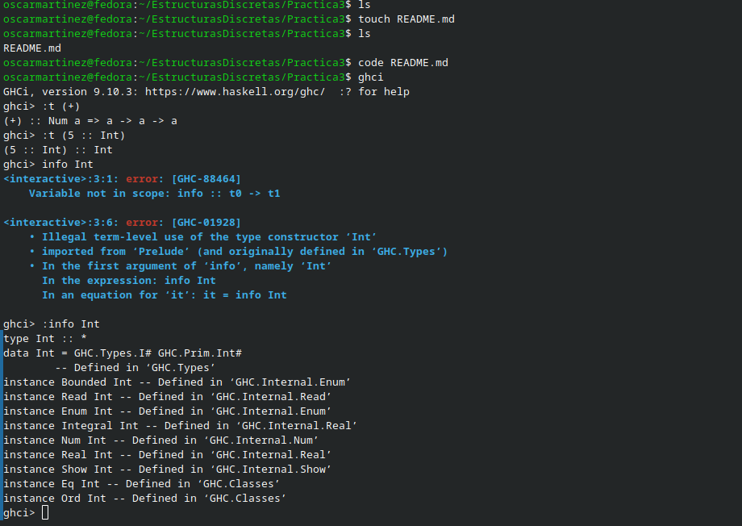

¿CUAL ES LA DIFERENCIA ENTRE INT Y NUM?

La diferencia es que Int es un tipo de dato específico que usamos solo para enteros, mientras que Num, es como una categoría más general que agrupa a todo lo que sea un número. 
Es decir, que Num solo dicta las reglas generales para poder sumar o multiplicar, y ya los tipos concretos como Int, Float o Double encajan ahí adentro como instancias.

Objetivo de la práctica
Aplicar los fundamentos de la programación funcional en Haskell, utilizando la separación de código en módulos, condicionales lógicas y listas por comprensión para resolver problemas matemáticos y financieros.

Tiempo requerido: 1 dia

Ejercicio favorito: El ejercicio de calculo de los Cetes.

Comentarios: Aún me cuesta un poco de trabajo mandar a llamar funciones correctamente, pero lo que más se me complica estructurar y entender en este momento son las listas por comprensión.
